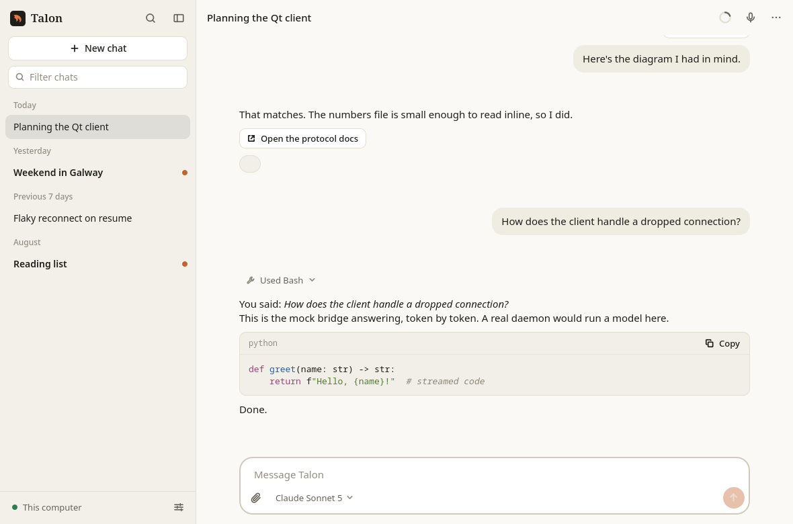
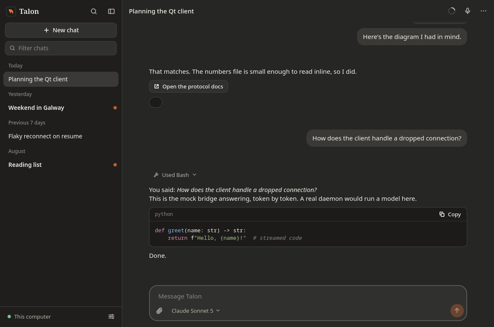
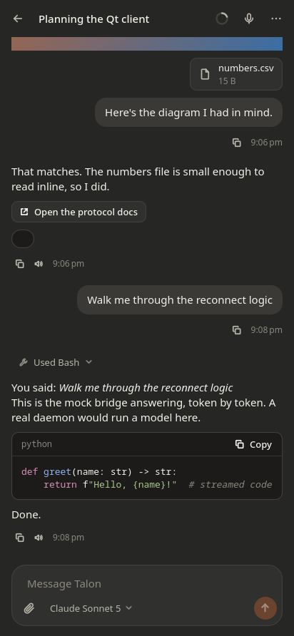
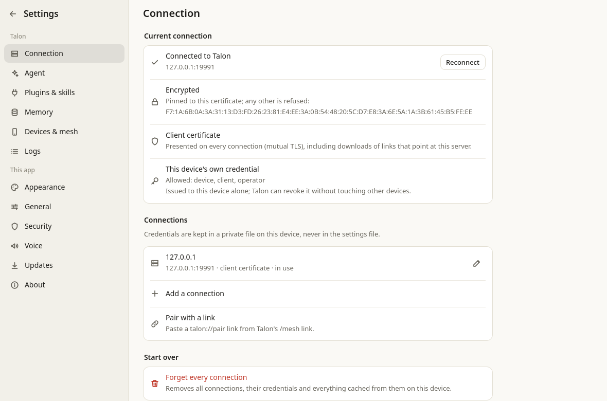

# Talos

Talos is a desktop and mobile client for [Talon](https://github.com/thefalconry/talon),
written in Qt 6 (C++ core, Qt Quick interface). One codebase for Linux,
Windows, macOS and Android.

It speaks Talon's Client Bridge Protocol (HTTP + Server-Sent Events) to a
daemon running the `native` frontend. It is a new client, written against the
daemon's protocol definition rather than ported from the Flutter companion.



| Dark | Phone | Mutual TLS |
| --- | --- | --- |
|  |  |  |

(Screenshots are of the app running against the bundled mock bridge.)

## What it does

**Chat**

- Chats grouped by day, filter by title, unread markers, rename, delete, reset
- Live replies: streamed text, the model's reasoning, and each tool call with
  its input, output, error and duration
- Markdown with fenced code blocks (copy button, syntax colouring), tables,
  images shown inline, file attachments
- Attach any files (picker, drag and drop, paste an image); uploads stream
  with progress
- Slash commands: completion from the daemon's own list, with each
  command's arguments. On a daemon too old to have one, the app carries out
  `/stop`, `/reset`, `/model`, `/effort` and `/pulse` itself
- Queue a follow-up while a turn runs, edit or cancel it from any device
- Stop a running turn
- Per-chat model, reasoning effort and backend
- Context-window meter with a reset
- Older history pages in as you scroll up
- `Ctrl+K`: run an action, jump to a chat, full-text search of every message
- Copy a conversation as Markdown
- Instant cold start from an offline snapshot

**Connection**

- *This computer*: finds a local Talon through its discovery file, optionally
  starting the daemon when it isn't running
- *Another machine*: address + token, HTTP or HTTPS
- **Certificate pinning.** A self-signed bridge certificate is shown for you
  to confirm before any token is sent, then pinned; a different certificate
  later is refused
- **Mutual TLS.** Import a `.p12`/`.pfx` client certificate for a bridge
  behind a reverse proxy that demands one. It is presented on every
  connection
- **Bridge links open inside the app.** A link that points at the connected
  server (a file, `/media`, the secret-drop form, a pairing page) is fetched
  over the app's own connection, with the client certificate, the pin and
  the token. A system browser has no client certificate and could not open
  them
- A home-network address that is preferred whenever it answers
- Pairing by link: a `talon://pair` link (pasted, clicked, or passed on the
  command line), or the address of the pairing page `/mesh link` gives you,
  which the app redeems itself
- Trades the shared bridge token for a per-device credential, and rotates it
  when Talon asks
- Several saved connections; credentials live in the system keyring
- Reconnects on its own: backoff, a dead-stream timeout, network changes,
  resume from sleep, and daemon restarts

**Talon itself**

- Read and change the daemon's settings (name, default model, timezone,
  heartbeat, pulse, dream), see its health, restart it, run a dream
- Turn plugins and skills on and off
- Browse what Talon remembers, and why
- Daemon log viewer with level filter, text filter and follow

**Mesh device**

- Registers this device, answers `ring`, `status` and `locate`
- With device control granted for that server: `exec`, `read_file`,
  `write_file`, `list_dir`, `stat`, `delete`, `mkdir`, `move`, and streamed
  `upload_file` / `download_file` with SHA-256 checks
- Optional approval prompt before every command, command limits, and an
  audit trail of everything run
- **Background service** (Linux): `talos --headless` keeps the device on the
  mesh with the app closed; Settings or `talos service install` sets it up
  as a systemd user unit
- **`update_node`**: Talon can push a new Talos build. It is installed only
  if it matches the SHA-256 Talon names, is a Talos build (a talon-node
  binary is refused) and is not older than the running one
- **`computer`** (Linux, experimental): screenshot, pointer and keyboard
  through the desktop's own remote-control portal, which asks you first and
  shows when a session runs

**The app**

- Light and dark themes, accent colour, text size
- Notifications, tray, launch at sign-in
- App lock: a passcode (Argon2id) that covers the window and encrypts the
  cached chats (XChaCha20-Poly1305), with fingerprint unlock on Linux
  (fprintd) and fingerprint or face on Android (a keystore key released by
  the system's biometric prompt)
- Read replies aloud; hands-free voice mode on Android
- Update check against a GitHub repository's releases, with checksum
  verification

## Build

Needs Qt 6.8 or newer (developed on 6.11) with the Qt Quick, Multimedia,
TextToSpeech and Positioning modules, CMake 3.21+ and a C++20 compiler.

### Linux

```bash
cmake -S . -B build -G Ninja -DCMAKE_BUILD_TYPE=Release
```

```bash
cmake --build build
```

```bash
./build/talos
```

With a Qt from the Qt installer or `aqt` instead of the distribution's, add
`-DCMAKE_PREFIX_PATH=$HOME/Qt/6.11.2/gcc_64` to the first command.

### Windows and macOS

The same three commands from a Qt command prompt, or open `CMakeLists.txt`
in Qt Creator. `windeployqt` / `macdeployqt` collect the Qt libraries for
distribution.

### Android

```bash
~/Qt/6.11.2/android_arm64_v8a/bin/qt-cmake -S . -B build-android -G Ninja \
  -DQT_HOST_PATH=$HOME/Qt/6.11.2/gcc_64 \
  -DANDROID_SDK_ROOT=$HOME/Android/Sdk \
  -DANDROID_NDK_ROOT=$HOME/Android/Sdk/ndk/27.2.12479018 \
  -DCMAKE_BUILD_TYPE=Release
```

```bash
cmake --build build-android
```

The APK lands under `build-android/android-build/build/outputs/apk/`.

### Packages

```bash
packaging/fedora/build-rpm.sh
```

builds `dist/talos-<version>-1.<dist>.x86_64.rpm` from the committed tree.
It depends on Fedora's own Qt 6 packages rather than bundling Qt.

```bash
packaging/android/build-apk.sh
```

builds and signs `dist/talos-<version>-arm64.apk`. It signs with the keystore
named by `TALOS_KEYSTORE` (see the script); an APK can only be updated by
one signed with the same key, so keep that file.

### Options

| CMake option | Meaning |
| --- | --- |
| `TALOS_UPDATE_REPO` | GitHub `owner/repo` whose releases the updater watches. Empty by default; it can also be set in Settings |
| `TALOS_BUILD_TESTS` | Build the tests (default on) |

## Connecting

Run Talon with the native bridge:

```jsonc
// ~/.talon/config.json
{ "frontend": "native", "native": { "host": "127.0.0.1", "port": 19880 } }
```

On the same machine choose **This computer**. For another machine set
`"host": "0.0.0.0"` and a `"token"`, choose **Another machine**, and enter
the address and token. Behind a reverse proxy with client certificates
([Talon's guide](https://github.com/thefalconry/talon/blob/main/docs/mtls.md)),
enter the proxy's `https://` address and import the `.p12` under *Client
certificate, pinning and more*.

## Trying it without Talon

`tools/mock-bridge.mjs` stands in for a daemon: every route, sample chats,
and a canned streaming reply.

```bash
node tools/mock-bridge.mjs --port 19880 --token secret
```

Add `--tls` for a self-signed HTTPS bridge, or `--mtls` to also demand a
client certificate (it writes a `client.p12` and prints where). To keep a
trial apart from your real settings and keyring:

```bash
TALOS_HOME=/tmp/talon-trial ./build/talos
```

## Tests

```bash
ctest --test-dir build --output-on-failure
```

The suite covers the pure logic (address parsing, pairing links, the SSE
parser, Markdown blocks, crypto, the wire fixtures) and drives a real
session against the mock bridge over plain HTTP, self-signed TLS and mutual
TLS: credential upgrade, certificate pinning and refusal, in-app bridge
downloads, the secret drop, and every mesh command. The integration half
needs `node`, and `openssl` for the TLS cases; without them those cases are
skipped.

## Layout

```
src/core/    protocol and state, no UI
  BridgeClient   HTTP + SSE transport, TLS pinning, client certificates
  Session        connection lifecycle, chats, messages, live turns
  BridgeLinks    in-app handling of links served by the bridge
  Store          preferences, profiles, snapshot; SecretStore for credentials
src/mesh/    this device on Talon's mesh: commands, transfers, audit
src/app/     app lock, updater, voice, tray and notifications, QML glue
qml/         the interface
tools/       mock bridge
tests/       unit and integration tests, protocol fixtures
```

## What is different from, or missing against, Talon's own clients

- **Voice.** Speech input uses Android's recogniser; desktop has none, so
  voice mode there reads replies and takes typed turns. There is no
  on-device neural voice (the companion's Kokoro model); the system's
  text-to-speech is used.
- **Android background mesh.** The mesh runs while the app is alive. There
  is no foreground service keeping it up after the app is swiped away.
- **Fallback endpoints.** A daemon with `native.endpoints` set tells mesh
  devices other ways to reach it (a second name, a fixed IP for when DNS is
  down). talon-node follows that list; Talos stays on the address it was
  given.
- **Android root / Shizuku and `install_apk`.** Commands run as the app's own
  user. `install_apk` is not offered and is refused if sent.
- **`computer`** covers screenshot, move, click, drag, scroll, type and key
  on Linux desktops that have the RemoteDesktop portal. `snapshot` (the
  accessibility tree) is not implemented, and the pointer position reported
  is where Talos last put it, because Wayland does not reveal the real one.
- **`update_node`** replaces a copy of Talos the user can write to (a build
  tree, a portable install). A system package is left to its package
  manager, and the capability is then not advertised.
- **Fingerprint unlock on Linux** is a convenience: fprintd confirms the
  finger and the key is read from the login keyring, which is what protects
  it at rest. On Android the device itself releases the key.
- **The background service** keeps credentials in an owner-only file while
  it is installed, as talon-node does, because it runs with no desktop
  session and so no unlocked keyring. Fingerprint unlock is unavailable in
  that mode.
- **Updates.** The app downloads and verifies a release, then hands it to
  the system; it does not replace itself in place. No release repository is
  configured by default.
- **Secrets on Android** are kept in the app's private storage rather than
  the hardware keystore (the biometric key is the exception).
- **Inline buttons without a link** are treated as quick replies: clicking
  one sends its label as your message. The bridge has no callback route.

## Build status

- **Linux**: built, tested (the suite above) and run, including against
  Fedora's own Qt 6.11 libraries.
- **Android**: builds a signed arm64 APK. It has not been run on a device,
  so the Android-only code (notifications, battery, ringtone, speech input,
  screen privacy, biometric unlock) is compiled but untried.
- **Windows and macOS**: on hold. Their platform code (DPAPI and Keychain
  secret storage, battery, launch at sign-in) is written but has never been
  through a compiler; the background service, screen control and biometric
  unlock have no backend there yet.
- **Not exercised on real hardware or a live desktop**: fingerprint unlock
  (no reader was available) and `computer`'s pointer and keyboard injection
  (it needs a person to accept the desktop's consent dialog). Their pure
  logic is covered by tests.

## Licence

Talos is free software under the GNU General Public License, version 2 only
(`GPL-2.0-only`); see [LICENSE](LICENSE). It links Qt 6, which is available
under the GPL version 2 among other licences. Bundled third-party material
and its terms are listed in [THIRD_PARTY.md](THIRD_PARTY.md).
